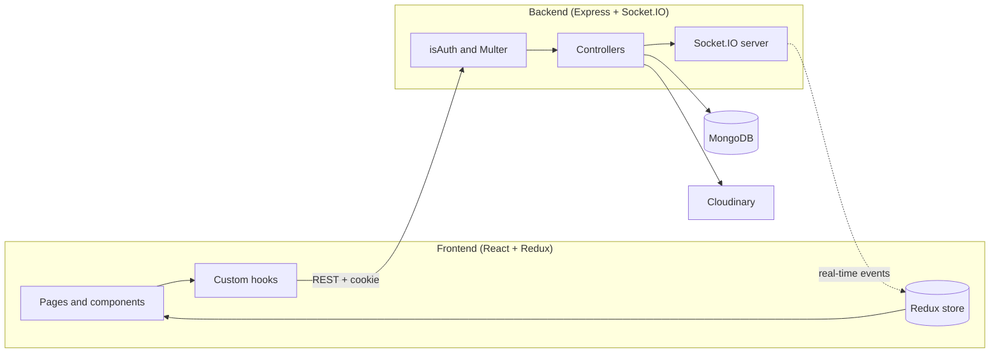
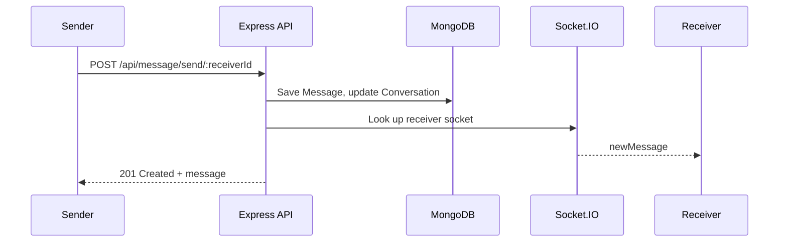
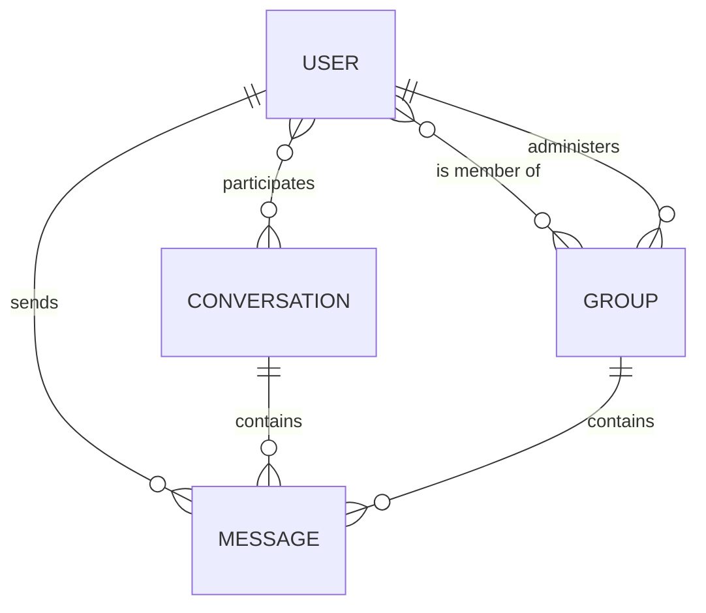

<div align="center">


# SyncUp

**A WhatsApp-style real-time chat app with 1:1 chats, group chats, image sharing and message deletion.**

</div>

## Table of Contents
[Introduction](#introduction) · [Features](#features) · [Tech Stack](#tech-stack) · [Architecture](#architecture) · [Folder Structure](#folder-structure) · [Database Schema](#database-schema) · [API Documentation](#api-documentation) · [Installation and Setup](#installation-and-setup) · [Environment Variables](#environment-variables) · [Technical Decisions](#technical-decisions) · [License ](#license)

---

## Introduction
SyncUp is a full-stack MERN application that covers real-time messaging end to end: authentication, persistent storage, live delivery over WebSockets, media uploads and group management.

Messages are saved to MongoDB through a REST API and pushed instantly to online recipients via Socket.IO. Offline users receive them on their next load. The UI is a responsive, WhatsApp-inspired layout built with React and Tailwind CSS.

## Features

**Authentication and profile**
- Sign up and log in with email and password (bcrypt-hashed, minimum 6 characters)
- JWT stored in an `httpOnly` cookie (7-day expiry, `SameSite=Strict`)
- Edit display name and profile picture (uploaded to Cloudinary)

**Messaging**
- Real-time one-to-one chat with text, emoji and image messages
- Live online-presence updates
- **Delete for me** (hides the message for you only) and **Delete for everyone** (sender only)

**Groups**
- Create a group with a name, optional image and at least one other member
- Admin can add and remove members; any member can leave
- If the admin leaves, the oldest remaining member becomes admin; an empty group is deleted
- Group messages show the sender's name and avatar
- Sidebar and member lists update live (`groupCreated`, `groupUpdated`, `removedFromGroup`)

## Tech Stack

| Layer | Technology | Purpose |
|---|---|---|
| Frontend | React 19, Vite 8 | UI and dev tooling |
| | Redux Toolkit, React Router 7 | State management and routing |
| | Tailwind CSS 3, react-icons, emoji-picker-react | Styling and UI elements |
| | Axios, socket.io-client | REST calls and real-time events |
| Backend | Node.js (ESM), Express 5 | HTTP server and REST API |
| | Socket.IO 4 | WebSocket events, presence and rooms |
| | Mongoose 9 | MongoDB object modelling |
| | bcryptjs, jsonwebtoken, cookie-parser, cors | Auth and security basics |
| | Multer | Multipart upload handling |
| Services | MongoDB, Cloudinary | Database and media storage |

## Architecture



**Sending a message**



**Socket.IO events** (the client connects with `query: { userId }`)

| Event | Direction | Payload | Purpose |
|---|---|---|---|
| `getOnlineUsers` | server → all | `string[]` of user ids | Presence |
| `newMessage` | server → receiver | Message | 1:1 delivery |
| `newGroupMessage` | server → group room | Message (sender populated) | Group delivery |
| `messageDeleted` | server → receiver / group room | `{ messageId, mode, groupId? }` | Delete for everyone |
| `groupCreated` | server → each member | Group | Sidebar update |
| `groupUpdated` | server → group room | Group | Member or admin change |
| `removedFromGroup` | server → removed member | `{ groupId }` | Remove group from UI |
| `joinGroup` / `leaveGroup` | client → server | `groupId` | Room membership |

## Folder Structure

```
SyncUp/
├── backend/
│   ├── config/
│   │   ├── cloudinary.js        # Upload helper (deletes temp file afterwards)
│   │   ├── db.js                # MongoDB connection
│   │   └── token.js             # JWT generation (7-day expiry)
│   ├── controllers/
│   │   ├── auth.controllers.js  # signUp, login, logOut
│   │   ├── user.controllers.js  # current user, other users, edit profile
│   │   ├── message.controller.js# 1:1 + group messages, delete
│   │   └── group.controller.js  # create, details, add/remove, leave
│   ├── middlewares/
│   │   ├── isAuth.js            # Verifies the JWT cookie
│   │   └── multer.js            # Temp disk storage in ./public
│   ├── models/                  # user, conversation, message, group
│   ├── routes/                  # auth, user, message, group
│   ├── socket/socket.js         # Socket.IO server, presence, group rooms
│   ├── public/                  # Temporary upload directory
│   └── index.js                 # App entry point
└── frontend/
    ├── public/                  # Static assets and logo
    └── src/
        ├── components/          # SideBar, MessageArea, Sender/ReceiverMessage,
        │                        # CreateGroupModal, GroupInfoModal
        ├── customHooks/         # Data-fetching hooks, useGroupSocketEvents
        ├── pages/               # Home, Login, SignUp, Profile
        ├── redux/               # store, userSlice, messageSlice, groupSlice
        ├── socket.js            # Socket init, reuse and close
        ├── App.jsx              # Routes and auth redirects
        └── main.jsx             # Entry point and serverUrl
```

## Database Schema



**User**

| Field | Type | Notes |
|---|---|---|
| `name` | String | Display name |
| `userName` | String | Required, unique |
| `email` | String | Required, unique |
| `password` | String | Required, bcrypt hash |
| `image` | String | Cloudinary URL, default `""` |

**Conversation**

| Field | Type | Notes |
|---|---|---|
| `participants` | [ObjectId → User] | The two chat partners |
| `messages` | [ObjectId → Message] | Ordered message references |

**Message**

| Field | Type | Notes |
|---|---|---|
| `sender` | ObjectId → User | Required |
| `receiver` | ObjectId → User | Required unless `group` is set |
| `group` | ObjectId → Group | Set for group messages, else `null` |
| `message` | String | Text, default `""` |
| `image` | String | Cloudinary URL |
| `deleted` | Boolean | `true` after "delete for everyone" |
| `deletedFor` | [ObjectId → User] | Users who hid it via "delete for me" |

**Group**

| Field | Type | Notes |
|---|---|---|
| `name` | String | Required, trimmed |
| `image` | String | Optional Cloudinary URL |
| `admin` | ObjectId → User | Required, only admin can add or remove members |
| `members` | [ObjectId → User] | Includes the admin |
| `messages` | [ObjectId → Message] | Group message references |

**Relationships:** every message belongs to either a conversation (`receiver` set) or a group (`group` set), never both. All collections use `timestamps` (`createdAt`, `updatedAt`).

## API Documentation

**Base URL:** `http://localhost:8000/api`
**Auth:** login and signup set a `token` cookie. Every route except `/auth/*` requires it, so send credentials with each request (`withCredentials: true` in Axios).

| Method | Endpoint | Description |
|---|---|---|
| POST | `/auth/signup` | Create account and log in |
| POST | `/auth/login` | Log in |
| GET | `/auth/logout` | Clear the auth cookie |
| GET | `/user/current` | Logged-in user |
| GET | `/user/others` | All users except you |
| PUT | `/user/profile` | Update name and image (multipart) |
| POST | `/message/send/:receiverId` | Send a 1:1 message (multipart) |
| GET | `/message/get/:receiver` | Fetch a 1:1 conversation |
| POST | `/message/group/send/:groupId` | Send a group message (multipart) |
| GET | `/message/group/get/:groupId` | Fetch group messages |
| DELETE | `/message/delete/:messageId` | Delete for me or everyone |
| POST | `/group/create` | Create a group (multipart) |
| GET | `/group/my` | Groups you belong to |
| GET | `/group/:groupId` | Group details |
| PUT | `/group/:groupId/add-members` | Add members (admin) |
| PUT | `/group/:groupId/remove-member` | Remove a member (admin) |
| POST | `/group/:groupId/leave` | Leave a group |

### Examples

**Sign up** `POST /auth/signup`

```json
{ "userName": "john_doe", "email": "john@example.com", "password": "secret123" }
```

`201 Created`

```json
{
  "_id": "665f1c2e9b1d8a0012a4b7c1",
  "userName": "john_doe",
  "email": "john@example.com",
  "image": "",
  "createdAt": "2026-01-10T09:30:00.000Z",
  "updatedAt": "2026-01-10T09:30:00.000Z"
}
```

> The user document is currently returned as stored, including the hashed `password` field.

Errors: `400` with `"userName already exist"`, `"email already exist"` or `"passsword must be at least 6 character"`.

**Log in** `POST /auth/login`

```json
{ "email": "john@example.com", "password": "secret123" }
```

Returns `201` with the user document. Errors: `400` with `"user does not exist"` or `"incorrect password"`.

**Send a message** `POST /message/send/:receiverId` (`multipart/form-data`)

| Field | Type | Required |
|---|---|---|
| `message` | text | Optional if `image` is sent |
| `image` | file | Optional |

`201 Created`

```json
{
  "_id": "665f2a0b9b1d8a0012a4b7d4",
  "sender": "665f1c2e9b1d8a0012a4b7c1",
  "receiver": "665f1d4f9b1d8a0012a4b7c9",
  "group": null,
  "message": "Hey, are you free?",
  "image": null,
  "deleted": false,
  "deletedFor": [],
  "createdAt": "2026-01-10T09:35:00.000Z",
  "updatedAt": "2026-01-10T09:35:00.000Z"
}
```

**Get messages** `GET /message/get/:receiver`
Returns `200` with an array of messages, excluding ones you deleted for yourself. An empty array `[]` means no conversation yet.

**Delete a message** `DELETE /message/delete/:messageId`

```json
{ "mode": "everyone" }
```

`mode` is `"me"` (default) or `"everyone"`. Returns `200` with the updated message. Errors: `403` `"You can only delete your own messages for everyone"`, `404` `"Message not found"`.

**Create a group** `POST /group/create` (`multipart/form-data`)

| Field | Type | Required |
|---|---|---|
| `name` | text | Yes |
| `members` | JSON array of user ids (or comma-separated) | Yes, at least 1 |
| `image` | file | Optional |

Returns `201` with the populated group (`admin` and `members` expanded, passwords excluded). You are always added as admin and member.

**Group rules**
- `add-members` body: `{ "members": ["<userId>", "..."] }`, `remove-member` body: `{ "memberId": "<userId>" }`. Admin only (`403` otherwise). The admin cannot remove themselves, they must use `leave`.
- `leave` returns `{ "message": "Left group successfully", "deleted": false }`. `deleted` is `true` when the last member leaves.
- Group message routes return `403` `"You are not a member of this group"` for non-members and `400` `"Message cannot be empty"` when both text and image are missing.

**Auth errors (all protected routes)**

| Status | Body | Cause |
|---|---|---|
| 400 | `{ "message": "token is not found" }` | Missing cookie |
| 500 | `{ "message": "isauth error" }` | Invalid or expired token |

## Installation and Setup

### Prerequisites
- **Node.js** 20.19+ (or 22.12+) and npm
- **MongoDB**: local instance or a free [MongoDB Atlas](https://www.mongodb.com/atlas) cluster
- **Cloudinary** account (the free tier is enough)
- Git

### 1. Clone the repository
```bash
git clone <your-repo-url>
cd SyncUp
```

### 2. Backend
```bash
cd backend
npm install
# create backend/.env (see Environment Variables)
npm run dev          # nodemon, http://localhost:8000
```

### 3. Frontend
Open a second terminal:
```bash
cd frontend
npm install
npm run dev          # Vite, http://localhost:5173
```

### 4. Try it
Open `http://localhost:5173`, sign up two accounts (use a normal and an incognito window) and start chatting.

| Location | Script | Description |
|---|---|---|
| backend | `npm run dev` | Start server with nodemon |
| frontend | `npm run dev` | Start Vite dev server |
| frontend | `npm run build` / `preview` | Production build and local preview |
| frontend | `npm run lint` | Run ESLint |

> **Heads up:** CORS and Socket.IO allow only `http://localhost:5173`, and the frontend API URL is hardcoded as `serverUrl` in `frontend/src/main.jsx`. Update these before deploying.

### Troubleshooting
- `vite: not found` → run `npm install` inside `frontend/`.
- Socket not connecting or API calls failing → confirm `PORT=8000` in `backend/.env`.
- Cookie not saved → use `localhost` for both apps (`SameSite=Strict`).

## Environment Variables
Create `backend/.env` (already git-ignored). The frontend needs no `.env`.

| Variable | Required | Description | Example |
|---|---|---|---|
| `PORT` | Recommended | Server port. Use `8000` to match the frontend `serverUrl` (defaults to `5000`) | `8000` |
| `MONGODB_URL` | Yes | MongoDB connection string | `mongodb://127.0.0.1:27017/convosphere` |
| `JWT_SECRET` | Yes | Secret for signing JWTs, use a long random string | `a1b2c3...` |
| `CLOUD_NAME` | Yes | Cloudinary cloud name | `my-cloud` |
| `API_KEY` | Yes | Cloudinary API key | `123456789012345` |
| `API_SECRET` | Yes | Cloudinary API secret | `abcDEF...` |

```env
PORT=8000
MONGODB_URL=mongodb://127.0.0.1:27017/convosphere
JWT_SECRET=<random-string>
CLOUD_NAME=<cloudinary-cloud-name>
API_KEY=<cloudinary-api-key>
API_SECRET=<cloudinary-api-secret>
```

Generate a secret: `node -e "console.log(require('crypto').randomBytes(32).toString('hex'))"`

## Technical Decisions

| Decision | Why |
|---|---|
| JWT in an `httpOnly` cookie | Keeps the token out of JavaScript reach, reducing XSS token theft |
| One Socket.IO room per group | Group fan-out is a single `io.to(room).emit`, with no per-member loops. Users auto-join their rooms on connect |
| In-memory `userSocketMap` (userId → socketId) | Simple, fast lookup for 1:1 delivery. Disconnect handling only removes an entry if the socket id still matches, so reconnects and multiple tabs don't wipe a newer socket |
| Redux deduplication by `_id` | A message can arrive twice (HTTP response and socket event), so the store keeps a single copy |
| Single `Message` model for 1:1 and group | `receiver` XOR `group`: one schema, one delete flow, one render path |
| Soft deletes | "Delete for everyone" clears content and sets `deleted`. "Delete for me" adds the user to `deletedFor`. Documents are kept, matching WhatsApp semantics |
| Server-side permission checks | Only the sender can delete for everyone, only the admin can add or remove members, and only members can read or post in a group |
| Multer temp file → Cloudinary | Media never lives on the app server. The temp file is removed after success and on failure |
| Infinite client reconnection (capped backoff) | A server restart no longer leaves the UI "connected" but silently offline |
| Socket closed on logout | The next login opens a fresh socket tagged with the correct user id |

## License 

### License
Released under the **ISC License**, as declared in the project's `package.json`. You may use, copy, modify and distribute the software freely, provided the copyright and permission notice is kept.
